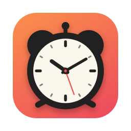
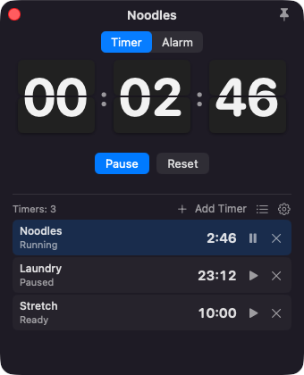
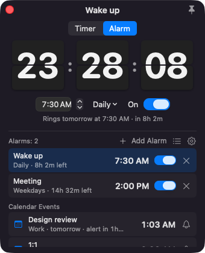
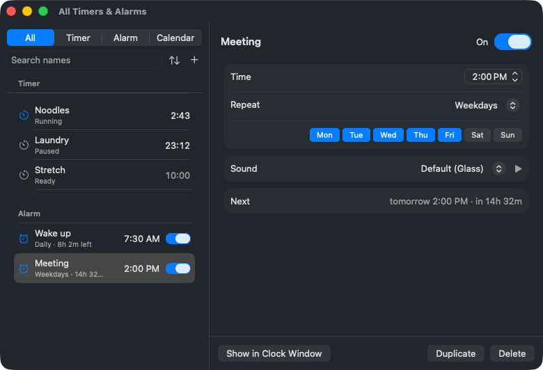
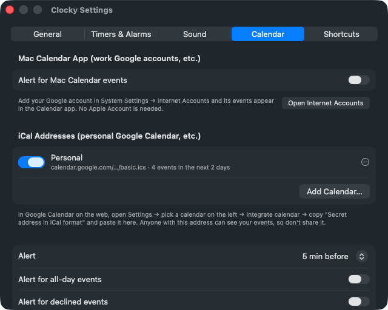

<p align="center"></p>

<h1 align="center">Clocky</h1>

<p align="center">Flip-clock timers, alarms, and calendar alerts from your Mac's menu bar</p>

<p align="center"><a href="README.md">한국어</a> · <b>English</b></p>

<p align="center"> </p>

Clocky keeps a small window on screen whose digit cards flip every second, like a desk flip clock. It lives in the menu bar only and doesn't add a Dock icon. It's a companion to the sticky-note app [Floaty](https://github.com/eddieee-git/Floaty).

## Features

- **Multiple timers:** Give each timer its own name and duration and run them independently. Set the time with the duration buttons (1, 3, 5, 10, 25 minutes by default) or type it (`90` = 90 minutes, `5:30`, `1:30:00`). Pause, resume, and reset.
- **Multiple alarms:** Each alarm has a name, a time, a repeat (Daily, Weekdays, Weekends, Once, or chosen days), an on/off switch, and a sound. The list shows how long until each one rings.
- **Calendar alerts:** Events from Google Calendar and other calendars ring like an alarm before they start (5 minutes before by default). Connect through the Mac Calendar app (works with work Google accounts) or with an iCal address. See [Connecting a calendar](#connecting-a-calendar).
- **Warning and ringing:** The window flashes red for 10 seconds before something rings. When it's time, the window comes to the front, shows what's ringing, and plays a sound. The sound repeats until you stop it (up to 1 minute by default). **Snooze** rings again after a set time (5 minutes by default).
- **Menu bar:** Shows the time left on a running timer. When no timer is running, it shows the countdown to an alarm or event within the next hour, with a bell icon.
- **All Timers & Alarms:** Find every timer, alarm, and event in one window, and turn on, turn off, or delete several at once.
- **Keyboard:** Shortcuts inside the window, plus global shortcuts that work while you're in other apps. See [Shortcuts](#shortcuts).
- **Accessibility:** VoiceOver reads the clock face as one sentence, such as "Noodles, 2 minutes 46 seconds left." With Reduce Motion on, the digits change without flipping and the red background doesn't blink.
- **English and Korean:** Switch in Settings. Clocky starts in your Mac's language.

## Requirements

- A Mac with Apple silicon (M1 or later). Intel Macs aren't supported.
- macOS 13 or later. Clocky was developed and tested on macOS 26.

## Install

1. Download `Clocky-<version>.dmg` (`Clocky.dmg` up to 0.2.1) from [Releases](https://github.com/eddieee-git/mac-app-clocky/releases).
2. Open the dmg and drag Clocky to the Applications folder.
3. Open Clocky. An alarm-clock icon appears in the menu bar and the clock window opens.

> [!IMPORTANT]
> **macOS shows a security warning the first time you open Clocky.** Clocky is a free app and isn't notarized through Apple's paid developer program.
>
> Close the warning, then go to **System Settings → Privacy & Security**, scroll down, and click **Open Anyway**. You only need to do this once.

Clocky checks for a new version once a day and tells you in the menu bar menu. Click it to download and open the new dmg. See the [install guide](docs/install.en.md) for details, including how to update and uninstall.

## Using Clocky

### Menu bar

Click the alarm-clock icon in the menu bar.

| Item | What it does |
|---|---|
| Open Clocky | Opens the clock window |
| Status lines | One line for each running or paused timer, each alarm that's on, and each 📅 event in the next day. Click one to show it |
| All Timers & Alarms… (⌘L) | Review and edit every timer, alarm, and event in one window |
| Settings… (⌘,) | Language, menu bar display, warning, snooze, sound, calendars, shortcuts, and more |

### Clock window

Choose **Timer** or **Alarm** at the top. The list under the big clock face shows your items; the one you select appears on the clock face and in the controls. The name field at the very top is the selected item's name. The list and gear buttons above the list open All Timers & Alarms and Settings.

- **Timers:** Click **Add Timer**. Set a duration and click **Start**. The ▶︎ and ⏸ buttons in each row start or pause a timer without selecting it.
- **Alarms:** Click **Add Alarm** to add an alarm that rings daily at the next full hour. Change its time, repeat (the **Daily** menu), and **On** switch under the clock face. Calendar events for the next day appear under your alarms; the 🔔 button skips just that alert.
- **Deleting:** Click ✕ in a row. Press ⌘Z to bring it back. The last timer always stays.
- **When something rings:** The window comes to the front but leaves your keyboard in the app you were using. Click the window to stop it, or press ⌃⌥X from anywhere. If you were using the clock window, Esc works too. Click **Snooze** or press S to ring again later (a timer restarts with the snooze length).
- An item with no name is called by number, such as "Timer 2" or "Alarm 3".
- Timers and alarms keep running when you close the window, and the window comes back when something rings. The window never changes size and remembers where you put it.

### All Timers & Alarms

<p align="center"></p>

- On the left, filter by **All**, **Timer**, **Alarm**, or **Calendar**, search by name, and sort alarms by next to ring, time, name, or date added. Click **＋** to add a timer or alarm.
- Select an item to edit it on the right: a timer's name, duration, and start/pause; an alarm's name, on/off, time, repeat, sound, and snooze; or turn an event's alert on or off.
- Hold ⌘ or ⇧ to select several, then turn alarms on or off, duplicate, or delete them. One ⌘Z brings back everything you deleted.
- Double-click a row to show it on the clock window. While something rings, a red bar at the top lets you stop or snooze it.

### Connecting a calendar

<p align="center"></p>

There are two ways, and you can use both. Set them up in **Settings → Calendar**.

#### Through the Mac Calendar app (including work Google accounts)

1. In **System Settings → Internet Accounts**, add your Google account and turn on **Calendars**. No Apple Account is needed. Your events should appear in the Calendar app.
2. In Clocky, turn on **Alert for Mac Calendar events**. When macOS asks for calendar access, allow it.
3. Check only the calendars you want alerts for. All are checked at first.

Clocky picks up changes as soon as the Calendar app syncs. Because Clocky isn't signed with a developer certificate, macOS may ask for calendar access again after you update.

#### With an iCal address (personal Google Calendar, etc.)

1. Open [Google Calendar](https://calendar.google.com) on the web and go to **Settings → pick a calendar on the left → Integrate calendar**.
2. Copy **Secret address in iCal format**.
3. In Clocky, click **Add Calendar…**. The address you copied is filled in; click **Add**.

Clocky refreshes every 15 minutes and when your Mac wakes. To refresh right away, click **Refresh Now**. Anyone with the secret address can see your events, so don't share it. If it leaks, reset it in Google Calendar.

> [!NOTE]
> Work and school (Google Workspace) accounts may not show a **secret address** if an administrator turned it off. Use the Mac Calendar app instead. If the calendar is already public, its **Public address in iCal format** also works. Keep in mind that anyone who knows your email address can open a public address, and if the calendar only shares free/busy, alerts ring without event names.

#### Both ways

- Choose when alerts ring: at the start time, or 1, 5, 10, 15, or 30 minutes before.
- All-day events and events you declined don't ring by default. You can change that in Settings.
- Alerts ring while Clocky is running and your Mac is awake. An alert that passed while your Mac was asleep rings on wake if it's less than 15 minutes late. An event that already rang doesn't ring again after Clocky restarts.
- Clocky reads iCal addresses itself. It handles repeating events, skipped dates, single moved events, and time zones. Very rare repeat rules (such as "last weekday of the month") only alert at the first occurrence.

### Settings

| Tab | Settings |
|---|---|
| General | Language, Open at Login, Confirm before deleting, menu bar countdowns, Check for Updates Automatically |
| Timers & Alarms | Flash before ringing (off, 5, 10, 30, or 60 seconds), Snooze length (1–30 minutes), Keep ringing for (10 seconds–5 minutes), Timer buttons (minutes, up to 6) |
| Sound | Alarm sound (plays when you pick it), add or remove your own sound files, Volume |
| Calendar | Mac Calendar app and which calendars, add, turn on, or remove iCal addresses, Alert timing, all-day and declined events |
| Shortcuts | Change global shortcuts, list of window shortcuts |

### Shortcuts

These work while the clock window is in front. While you're editing a name, Space and the arrow keys type into the name field; press Esc to finish editing.

| Keys | Action |
|---|---|
| Space | Start or pause the selected timer; turn the selected alarm on or off |
| Return | Start or pause the selected timer |
| ↑ ↓ | Select the previous or next item |
| ⌘N | Add a timer or alarm |
| ⌘⌫ | Delete the selected item |
| ⌘Z, ⇧⌘Z | Undo or redo a delete |
| ⌘1, ⌘2 | Timer, Alarm |
| Esc | Stop ringing; finish editing a name |
| S | Snooze while ringing |
| ⌘L, ⌘, | All Timers & Alarms, Settings |

Global shortcuts work even while you're using other apps. Change or clear them in the **Shortcuts** tab in Settings. They don't need Accessibility permission.

| Default keys | Action |
|---|---|
| ⌃⌥C | Show or hide the clock window |
| ⌃⌥T | Start or pause the selected timer |
| ⌃⌥X | Stop ringing |
| (none) | Open All Timers & Alarms |

### Good to know

- Timers and alarms are kept when you restart Clocky, and running timers keep running.
- A timer that finished or an alarm that passed while Clocky was quit rings right away if you reopen Clocky within an hour.
- A timer that finished while your Mac was asleep rings when it wakes. Alarms ring only if they passed less than an hour earlier.
- If you change time zones or set the clock, alarms move to the new local time, while running timers and snoozes keep the time that actually passed.
- If you unplug a display and the window ends up off screen, it moves to a remaining display.

## Privacy and security

- Settings, alarms, and events stay on this Mac and aren't sent anywhere. Clocky has no third-party libraries.
- Clocky uses the internet only to download events from the iCal addresses you add and to check GitHub for a new version once a day. It accepts https iCal addresses only and hides the secret part on screen. When Clocky checks for updates, GitHub sees your IP address and Clocky's version, as with any web request. You can turn off update checks in Settings.
- Secret iCal addresses are stored in Clocky's settings file. macOS keeps other apps from reading it, but backups such as Time Machine include it.
- Clocky downloads and opens a new version only when its developer's signature (Ed25519) matches. Even if someone took over the GitHub account and replaced the file, Clocky wouldn't download it.
- Clocky asks for calendar access only when you turn on the Mac Calendar app option, and reads only each event's title, time, and your response.
- The app is signed with the App Sandbox and the Hardened Runtime. Outside its own folder, it reads only sound files you pick in Settings, and when you choose to update, it saves the new dmg to your Downloads folder. Settings are stored in `~/Library/Containers/com.eddieee.Clocky`.

## Building from source

You only need the Command Line Tools, not Xcode.

```bash
scripts/build-app.sh
```

This creates `build/Clocky.app` and `build/Clocky-<version>.dmg`. To redraw the icon, run `swift scripts/make-icon.swift`.

Run the tests with Swift Testing from the Command Line Tools:

```bash
scripts/test.sh
```

GUI tests that open real windows run with `scripts/gui-test.sh`. Each scenario in `Tests/GUI` is built and run on its own. The `calendar` scenario starts a small web server on your Mac and checks everything from downloading to ringing, the `update` scenario checks finding and downloading a new version from a server that mimics GitHub Releases, and `readme-shots` takes the screenshots for these docs in `build/shots`. Some scenarios fail while the screen is locked, because clicks can't reach the windows.

```bash
scripts/gui-test.sh
```

See the [changelog](CHANGELOG.md) for what's new.

## License

[MIT](LICENSE)
