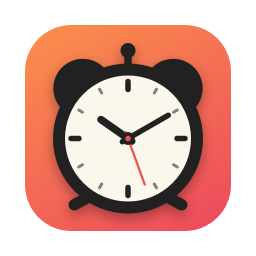
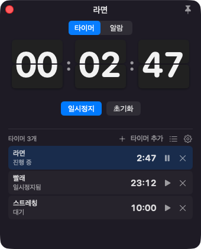
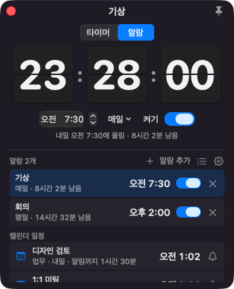
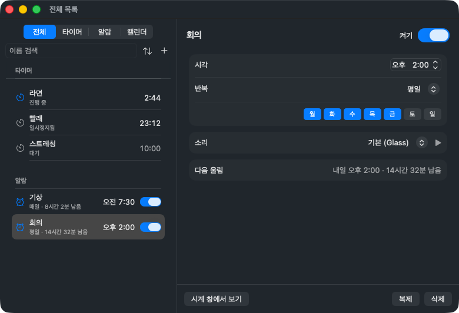
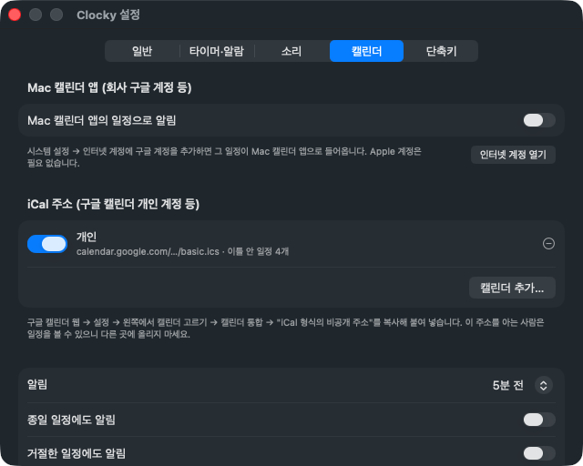

<p align="center"></p>

<h1 align="center">Clocky</h1>

<p align="center">macOS 메뉴바에서 꺼내 쓰는 넘김시계 타이머와 알람</p>

<p align="center"> </p>

탁상 넘김시계처럼 숫자판이 초마다 넘어가는 작은 창을 화면에 띄워 둡니다. Dock에 아이콘이 생기지 않고 메뉴바에만 상주합니다. 스티커 메모 앱 [Floaty](https://github.com/eddieee-git/Floaty)의 짝꿍 앱입니다.

## 주요 기능

- **타이머 여러 개:** 타이머를 원하는 만큼 더해 따로 돌립니다. 1·3·5·10·25분 버튼(설정에서 바꿈)이나 직접 입력(`90`은 90분, `5:30`, `1:30:00`)으로 시간을 정하고, 일시정지·계속·초기화를 씁니다. 도는 동안 메뉴바에 가장 먼저 끝나는 타이머의 남은 시간이 나옵니다. 도는 타이머가 없으면 1시간 안에 울릴 알람까지 남은 시간이 종 아이콘과 함께 나옵니다.
- **알람 여러 개:** 알람마다 시각, 반복, 켜기·끄기를 정합니다. 반복은 매일·평일·주말·한 번 중에서 고르거나 요일을 하나씩 고릅니다. 한 번 알람은 울린 뒤 꺼집니다. 목록에서 알람마다 울리기까지 남은 시간을 보여 줍니다. 알람마다 소리를 따로 정하거나 내 소리 파일을 쓸 수 있습니다.
- **구글 캘린더 일정 알림:** 구글 캘린더의 비공개 iCal 주소를 넣어 두면, Mac을 쓰는 동안 일정 시작 전(기본 5분 전)에 알람처럼 울립니다. 아래 [구글 캘린더 연결](#구글-캘린더-연결)을 보세요.
- **미리 알림:** 어느 타이머나 알람이든 울리기 10초 전부터(설정에서 바꿈) 창이 붉게 깜빡입니다. 시각이 되면 창이 앞으로 나와 울린 항목을 보여 주며 소리를 내고, 창 아무 곳이나 누르면 멈춥니다. 소리는 끌 때까지 되풀이되고 1분(설정에서 바꿈)이 지나면 소리만 멈춥니다. **다시 울림**을 누르면 정한 시간(기본 5분) 뒤에 한 번 더 울립니다.
- **이름:** 타이머와 알람마다 이름을 붙여 무엇을 위한 것인지 적어 둡니다.
- **키보드:** 아래 [단축키](#단축키)로 마우스 없이 다룹니다. 다른 앱을 쓰는 중에도 전역 단축키로 시계 창을 열고 타이머를 시작하고 울림을 끕니다.
- **손쉬운 사용:** VoiceOver가 숫자판을 "라면, 2분 46초 남음"처럼 한 문장으로 읽습니다. 시스템 설정의 "동작 줄이기"를 켜면 숫자판이 넘어가지 않고 바로 바뀌며, 붉은 배경도 깜빡이지 않고 옅게 물든 채로 있습니다.
- **항상 위:** 오른쪽 위 압정 버튼으로 켜고 끕니다. 기본은 켜짐입니다.
- **한국어·영어:** 설정에서 바로 바꿉니다. 처음에는 Mac의 언어를 따릅니다.

## 요구 사항

- Apple 실리콘 Mac (M1 이상). Intel Mac은 지원하지 않습니다.
- macOS 13 이상. 개발과 시험은 macOS 26에서 했습니다.

## 설치

1. [Releases](https://github.com/eddieee-git/mac-app-clocky/releases)에서 `Clocky.dmg`를 내려받습니다.
2. dmg를 열고 Clocky를 Applications 폴더로 끌어다 놓습니다.
3. Clocky를 실행합니다.

> [!IMPORTANT]
> **처음 실행할 때 macOS 보안 경고가 나옵니다.** Clocky는 무료로 배포하는 앱이라 Apple의 유료 개발자 인증(공증)을 받지 않았기 때문입니다.
>
> 경고 창을 닫은 뒤 **시스템 설정 → 개인정보 보호 및 보안**의 아래쪽에서 **그래도 열기**를 누르면 됩니다. 처음 한 번만 하면 됩니다.

자세한 내용은 [설치 안내](docs/install.md)를 보세요. 업데이트와 삭제 방법도 있습니다.

## 사용법

메뉴바의 자명종 아이콘을 누르면 메뉴가 나옵니다. 1시간 안에 울릴 알람이 있으면 아이콘이 종 모양으로 바뀌고 남은 시간이 나옵니다.

| 항목 | 내용 |
|---|---|
| Clocky 열기 | 시계 창을 띄웁니다. 처음 실행할 때는 저절로 뜹니다 |
| 타이머·알람 상태 | 돌거나 멈춘 타이머마다 남은 시간, 켜 둔 알람마다 시각과 남은 시간이 한 줄씩 나옵니다. 누르면 그 항목을 창에 띄웁니다 |
| 전체 목록… (⌘L) | 모든 타이머와 알람을 한 창에서 살피고 고칩니다 |
| 설정… (⌘,) | 언어, 로그인 시 자동 실행, 메뉴바 표시, 미리 깜빡임, 다시 울림 간격, 알람 소리와 크기 등을 바꿉니다 |

창 위쪽에서 **타이머**와 **알람**을 고릅니다. 큰 숫자판 아래에 목록이 있고, 목록에서 고른 항목을 큰 판과 버튼으로 다룹니다. 맨 위 이름 칸은 고른 항목의 이름입니다.

- **타이머:** **＋ 타이머 추가**로 타이머를 더합니다. 목록에서 타이머를 누르고 시간을 정한 뒤 **시작**을 누릅니다. 목록 줄의 ▶︎·⏸ 버튼으로 고르지 않은 타이머도 바로 시작하거나 멈출 수 있고, ✕로 지웁니다(마지막 하나는 남습니다). 잘못 지웠으면 ⌘Z로 되살립니다.
- **알람:** **＋ 알람 추가**를 누르면 다음 정각에 매일 울리는 알람이 켜진 채로 목록에 생깁니다. 숫자판 아래에서 시각, 반복(**매일** 메뉴), **켜기**를 고칩니다. 목록 줄에는 이름, 반복, 남은 시간, 시각, 켜기 스위치, ✕(지우기)가 있습니다. 지운 알람도 ⌘Z로 되살립니다.
- 울리는 동안 창 아무 곳이나 누르거나 Esc를 누르면 멈춥니다. **다시 울림** 버튼이나 S 키를 누르면 정한 시간 뒤에 다시 울립니다. 타이머는 그 시간짜리로 다시 돕니다.
- 이름을 비워 두면 "타이머 2", "알람 3"처럼 번호로 부릅니다. 언어를 바꾸면 함께 바뀝니다.
- 타이머와 알람 사이를 오가도 도는 타이머는 그대로 돕니다.
- 창을 닫아도 타이머와 알람은 계속 돌아갑니다. 끝나면 창이 다시 뜹니다.
- 창 크기는 바뀌지 않습니다. 항목이 많으면 목록 안에서 스크롤합니다. 창을 옮겨 두면 닫았다 열어도, 앱을 다시 켜도 그 자리에 뜹니다.
- 타이머와 알람은 앱을 다시 켜도 유지됩니다. 돌던 타이머는 이어서 돕니다.
- 앱이 꺼진 동안 끝난 타이머나 지난 알람은, 1시간 안에 앱을 다시 켜면 켜자마자 울립니다. 그보다 오래 지났으면 울리지 않습니다.
- Mac이 잠든 동안 끝난 타이머는 깨어나면 바로 울립니다. 알람은 1시간 안에 지난 것만 울립니다.
- 시간대를 바꾸거나 시계를 고치면 알람이 새 시각에 맞춰 다시 잡힙니다. 시계를 손으로 바꿔도 도는 타이머와 다시 울림은 실제로 흐른 시간대로 남습니다.
- 시계 창 목록 머리의 목록·톱니바퀴 버튼으로 전체 목록과 설정을 엽니다.
- 모니터를 빼서 창이 화면 밖으로 나가면 남은 화면으로 옮겨집니다.

### 전체 목록

<p align="center"></p>

시계 창은 크기가 고정이라, 여러 개를 한꺼번에 다룰 때는 메뉴의 **전체 목록…**(⌘L)을 씁니다.

- 왼쪽에서 **전체·타이머·알람**으로 거르고, 이름으로 찾고, 알람을 다음 울림·시각·이름·추가한 순으로 정렬합니다. **＋**로 새 타이머나 알람을 만듭니다.
- 항목을 고르면 오른쪽에서 고칩니다. 타이머는 이름, 시간(`90`, `5:30`, `1:30:00`), 시작·일시정지·초기화를, 알람은 이름, 켜기, 시각, 반복(매일·평일·주말·한 번 또는 요일 단추), 다시 울림 취소를 다룹니다.
- ⌘나 ⇧를 누른 채 여러 개를 골라 알람을 한꺼번에 켜거나 끄고, 복제하거나 지웁니다. 지운 것은 ⌘Z 한 번으로 모두 되살아납니다.
- 줄을 두 번 누르거나 **시계 창에서 보기**를 누르면 그 항목이 시계 창의 큰 숫자판에 나옵니다.
- 울리는 동안에는 창 위에 붉은 막대가 나와 이 창에서도 끄거나 다시 울림을 고를 수 있습니다.
- 알람마다 소리를 고를 수 있습니다. **기본**이면 설정의 알람 소리를 씁니다.

### 구글 캘린더 연결

<p align="center"></p>

1. 웹에서 [구글 캘린더](https://calendar.google.com)를 열고 **설정**(톱니바퀴)으로 갑니다.
2. 왼쪽 **내 캘린더의 설정**에서 알림을 받을 캘린더를 누르고, **캘린더 통합**의 **iCal 형식의 비공개 주소**를 복사합니다.
3. Clocky **설정 → 캘린더**에서 **캘린더 추가…**를 누릅니다. 복사해 둔 주소가 미리 채워져 있으면 **추가**를 누릅니다. 캘린더가 여러 개면 하나씩 넣고, 캘린더마다 켜고 끕니다.

> [!NOTE]
> 회사·학교(Google Workspace) 계정은 관리자가 막아 두어 **iCal 형식의 비공개 주소**가 보이지 않을 수 있습니다. 그럴 때는 아래 **Mac 캘린더 앱 경유**를 쓰세요. 이미 공개해 둔 캘린더라면 **iCal 형식의 공개 주소**를 넣어도 됩니다. 다만 공개 주소는 이메일만 알면 누구나 볼 수 있고, 공개 범위가 "한가함/바쁨만"이면 일정 이름 없이 울립니다.

#### Mac 캘린더 앱 경유 (회사 구글 계정 등)

1. **시스템 설정 → 인터넷 계정**에서 구글 계정을 추가하고 **캘린더**를 켭니다. Apple 계정은 필요 없습니다. Mac의 캘린더 앱에 일정이 보이면 됩니다.
2. Clocky **설정 → 캘린더**에서 **Mac 캘린더 앱의 일정으로 알림**을 켭니다. macOS가 캘린더 접근을 물으면 허용합니다.
3. 알림을 받을 캘린더만 체크합니다. 처음에는 모두 켜져 있습니다.

- 일정의 제목, 시각, 내가 거절했는지만 읽고, 이 Mac 밖으로 보내지 않습니다.
- Clocky는 개발자 인증서 없이 서명하므로, 앱을 새 버전으로 바꾸면 캘린더 접근을 다시 물을 수 있습니다. 거절했다면 **시스템 설정 → 개인정보 보호 및 보안 → 캘린더**에서 Clocky를 켭니다.

- 15분마다, 그리고 Mac이 깨어날 때 일정을 새로 받습니다. 바로 받으려면 **지금 새로 받기**를 누릅니다.
- 알림 시점은 일정 시작할 때, 1·5·10·15·30분 전 중에서 고릅니다. 종일 일정과 내가 거절한 일정은 기본으로 울리지 않습니다.
- 울리면 시계 창에 일정 이름이 나오고, 알람처럼 끄거나 다시 울림을 고릅니다. 시계 창의 알람 칸과 전체 목록의 **캘린더**에서 앞으로의 일정과 알림까지 남은 시간을 보고, 일정마다 이번 알림만 끌 수 있습니다.
- Clocky가 켜져 있고 Mac이 잠들어 있지 않을 때 울립니다. 잠든 사이에 지난 알림은 15분 안이면 깨어나서 울립니다.
- 반복 일정, 빠진 날짜, 한 번만 옮긴 일정, 시간대를 직접 해석합니다. 아주 드문 반복 규칙(예: "매달 마지막 평일")은 첫 시각만 알립니다.
- 비공개 주소를 아는 사람은 일정을 볼 수 있습니다. 주소는 이 Mac의 Clocky 설정에만 저장하고 화면에는 가려서 보여 줍니다. 주소가 새어 나갔다면 구글 캘린더에서 **재설정**하세요.

### 설정

| 탭 | 항목 |
|---|---|
| 일반 | 언어, 로그인 시 자동 실행, 삭제하기 전에 확인, 메뉴바에 타이머·알람 남은 시간 표시 |
| 타이머·알람 | 미리 깜빡이기(끄기, 5·10·30·60초 전), 다시 울림 간격(1~30분), 소리를 되풀이하는 시간(10초~5분), 타이머 버튼(분, 6개까지) |
| 소리 | 알람 소리(고르면 들려줌), 내 소리 파일 추가·지우기, 소리 크기 |
| 캘린더 | Mac 캘린더 앱 연동과 캘린더 고르기, 구글 캘린더 iCal 주소 넣기·켜기·빼기, 알림 시점, 종일·거절한 일정 포함 여부, 지금 새로 받기 |
| 단축키 | 전역 단축키 바꾸기, 창 안 단축키 안내 |

### 단축키

창이 앞에 있을 때 씁니다. 이름 칸을 고치는 중에는 스페이스·화살표가 글자 입력으로 갑니다. Esc로 편집을 끝내면 다시 단축키로 쓰입니다.

| 키 | 동작 |
|---|---|
| 스페이스 | 고른 타이머 시작·일시정지, 고른 알람 켜기·끄기 |
| Return | 고른 타이머 시작·일시정지 |
| ↑ ↓ | 목록에서 위·아래 항목 고르기 |
| ⌘N | 타이머 또는 알람 추가 |
| ⌘⌫ | 고른 항목 지우기 |
| ⌘Z, ⇧⌘Z | 지운 항목 되살리기, 다시 지우기 |
| ⌘1, ⌘2 | 타이머, 알람 |
| Esc | 울림 끄기, 이름 편집 끝내기 |
| S | 울리는 동안 다시 울림 |
| ⌘L | 전체 목록 (Clocky 창 어디서나) |
| ⌘, | 설정 (Clocky 창 어디서나) |

다른 앱을 쓰는 중에도 동작하는 전역 단축키입니다. 설정의 **단축키** 탭에서 바꾸거나 지웁니다. 손쉬운 사용 권한이 필요 없습니다.

| 기본 키 | 동작 |
|---|---|
| ⌃⌥C | 시계 창 보이기/숨기기 |
| ⌃⌥T | 고른 타이머 시작/일시정지 |
| ⌃⌥X | 울림 끄기 |
| (없음) | 전체 목록 열기 |

## 직접 빌드하기

Xcode 없이 Command Line Tools만 있으면 됩니다.

```bash
scripts/build-app.sh
```

`build/Clocky.app`과 `build/Clocky.dmg`가 만들어집니다. 아이콘을 다시 그리려면 `swift scripts/make-icon.swift`를 실행합니다.

시험은 Command Line Tools에 든 Swift Testing으로 돌립니다.

```bash
scripts/test.sh
```

창을 실제로 띄워 보는 시험은 `scripts/gui-test.sh`로 돌립니다. `Tests/GUI`의 시나리오마다 따로 빌드해 실행하고, `calendar` 시나리오는 이 Mac 안에 작은 웹 서버를 띄워 받아 오기부터 울리기까지 봅니다. `readme-shots` 시나리오는 README 이미지를 `build/shots`에 찍습니다. 화면이 잠겨 있으면 클릭이 창에 닿지 않아 일부 시나리오가 실패합니다.

```bash
scripts/gui-test.sh
```

## 알아 두기

- 설정과 알람은 이 Mac에만 저장됩니다. 외부 라이브러리가 없습니다. 인터넷은 설정에 넣은 캘린더 주소에서 일정을 받아 올 때만 쓰고, 다른 곳으로는 아무것도 보내지 않습니다.
- 앱은 앱 샌드박스와 강화 런타임을 켜서 서명합니다. 자기 폴더 밖의 파일은 설정에서 직접 고른 소리 파일만 읽고, 네트워크는 밖으로 나가는 연결만 엽니다. 캘린더는 설정에서 Mac 캘린더 연동을 켰을 때만 접근을 묻습니다.
- 0.2부터 설정과 알람은 샌드박스 컨테이너(`~/Library/Containers/com.eddieee.Clocky`)에 저장됩니다. 0.1에서 쓰던 설정은 처음 실행할 때 저절로 옮겨집니다.

## 라이선스

[MIT](LICENSE)
